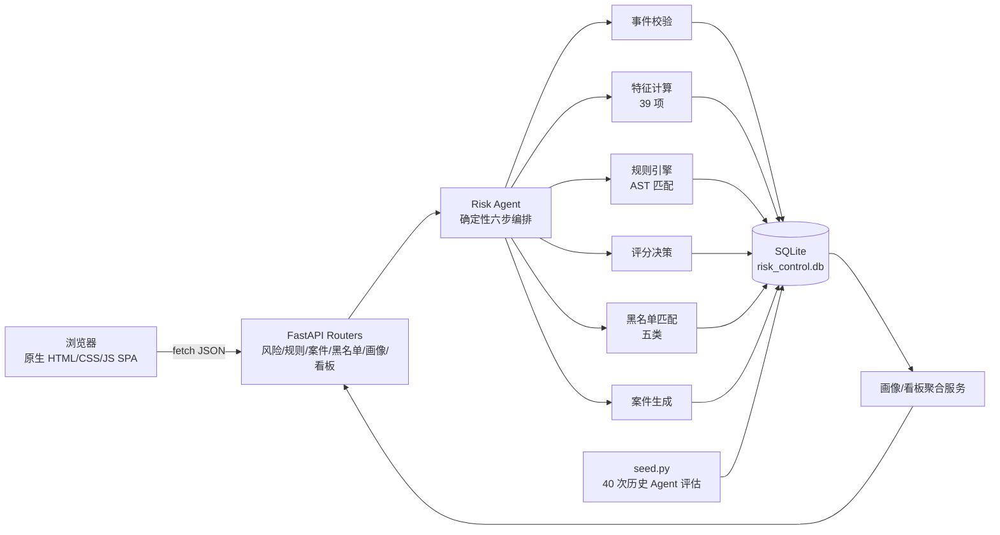
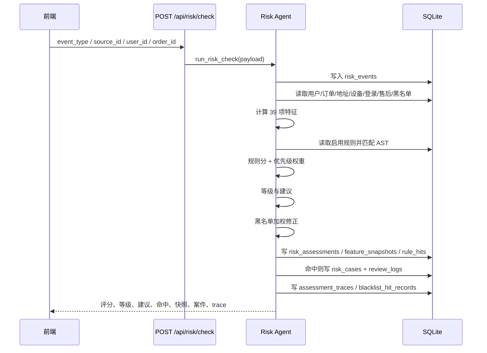

# 电商风险控制系统 · 设计说明

## 1. 项目概述

本项目面向电商业务，提供实时风险识别、规则判断、人工复核、处置留痕与结果回查能力。系统完全离线运行，不使用任何大模型 API 或外部服务，"Agent" 由确定性编排实现，保证可解释、可测试、可复现。

核心目标：

- 四类业务事件接入：`order_create`、`order_pay`、`after_sale_apply`、`logistics_complaint`；
- 39 项风险特征、30 条可配置规则、五类黑名单；
- 0-100 风险评分、三级风险、三种处理建议；
- 高风险自动建案、人工审核、审核日志、用户画像与运营看板；
- 全链路留痕：原始入参、特征快照、规则命中、Agent 六步轨迹、黑名单命中、审核日志。

---

## 2. 总体架构

### 2.1 分层架构



```text
┌──────────────────────────────────────────────────────────────────────┐
│ 浏览器：单页应用（hash 路由）                                          │
│  #/check  #/rules  #/cases  #/blacklist  #/profile  #/dashboard      │
│  原生 JS / 内联 SVG 图表 / 无 CDN、无外部字体                          │
└───────────────────────────────┬──────────────────────────────────────┘
                                │ HTTP JSON
┌───────────────────────────────▼──────────────────────────────────────┐
│ FastAPI 路由层                                                        │
│  routers/risk.py  rules.py  cases.py  blacklists.py  profile.py       │
│  dashboard.py  meta.py                                                │
├──────────────────────────────────────────────────────────────────────┤
│ 服务层 services/                                                      │
│  rule_service  blacklist_service  assessment_service  case_service    │
│  profile_service  dashboard_service                                   │
├──────────────────────────────────────────────────────────────────────┤
│ 领域层                                                                │
│  risk_agent.py（六步编排）  features.py（39 特征）                     │
│  rule_engine.py（AST/评分）  blacklist_matcher.py（黑名单）            │
├──────────────────────────────────────────────────────────────────────┤
│ 数据层 db.py + schema.sql + seed.py                                   │
│  SQLite：8 张核心表 + 6 张业务表 + 2 张审计辅助表                       │
└──────────────────────────────────────────────────────────────────────┘
```

### 2.2 请求时序



---

## 3. 模块划分

| 模块 | 文件 | 职责 |
| --- | --- | --- |
| 应用入口 | `app/main.py` | FastAPI 生命周期、异常处理、健康检查、离线 `/docs`、静态资源 |
| 数据访问 | `app/db.py` / `schema.sql` | SQLite 连接、建表、初始化、种子触发、事务提交/回滚 |
| 数据初始化 | `app/seed.py` | 读取 `data/*.json`，写入业务数据、规则、黑名单，执行 40 次历史评估并补齐审核状态 |
| 特征模块 | `app/features.py` | 39 项特征计算、特征元数据、城市距离、黑名单特征 |
| 规则模块 | `app/rule_engine.py` | AST 校验、条件求值、命中解释、规则匹配、分值汇总 |
| 黑名单 | `app/blacklist_matcher.py` | 五类黑名单匹配、历史生效时间过滤、直接加权 |
| 决策与编排 | `app/risk_agent.py` | 六步编排、trace、评估落库、自动建案 |
| 规则服务 | `app/services/rule_service.py` | 规则 CRUD、启停用、命中统计、条件二次校验 |
| 黑名单服务 | `app/services/blacklist_service.py` | 查询、新增、删除、批量导入、类型统计 |
| 评估服务 | `app/services/assessment_service.py` | 评估详情、最近评估、命中/快照/轨迹回查 |
| 案件服务 | `app/services/case_service.py` | 列表、详情、审核流转、审核日志、审核人映射 |
| 画像服务 | `app/services/profile_service.py` | 用户交易/售后/地址/设备/风险/案件聚合 |
| 看板服务 | `app/services/dashboard_service.py` | KPI、7 日趋势、等级分布、规则 TOP、黑名单命中、处理时长 |
| 前端 | `app/static/*` | 单页路由、六个页面、弹窗/抽屉/Toast、内联 SVG 图表、离线文档 |

---

## 4. Agent 六步编排

`run_risk_check()` 是唯一写入入口，保证"每次检查都保存原始入参、特征快照、命中规则、评估结果"。

| 步骤 | 名称 | 关键动作 | trace 中的 detail |
| --- | --- | --- | --- |
| 1 | 事件校验 | 校验事件类型、用户、订单、订单归属、订单时间；写入 `risk_events` | event_type、user_id、order_id、source_id |
| 2 | 特征计算 | 读取业务表，计算 39 项特征；执行黑名单初筛 | 特征数、黑名单初筛命中数、关键特征 |
| 3 | 规则匹配 | 读取启用规则，按优先级/分值排序，逐条求值 AST | 启用规则数、命中数、规则编码 |
| 4 | 评分决策 | 规则分 × 优先级权重求和，计算初步等级/建议 | 规则得分、初步等级、初步建议、阈值 |
| 5 | 黑名单校验 | 命中条目按类型直接加分，修正最终得分/等级/建议 | 命中条目、加权分、最终得分/等级/建议 |
| 6 | 案件生成 | `high` 或建议 `manual_review/reject` 时建案并写创建日志 | 是否建案、case_id、case_no、状态 |

每一步记录 `step`、`name`、`status`（success / warning / skipped）、`duration_ms`、`summary`、`detail`、`at`，序列化到 `assessment_traces.trace_json`。

---

## 5. 特征体系（39 项）

特征来源真实业务表，计算时使用"事件发生时间"作为时间基准，历史评估不会读取未来数据。

| 维度 | 特征键 | 名称 | 单位 | 说明 |
| --- | --- | --- | --- | --- |
| 事件维度 | event_type | 事件类型 | — | 本次风险检查的业务事件类型 |
| 用户维度 | user_register_days | 注册天数 | 天 | 用户注册至本次事件发生的天数 |
| 用户维度 | user_order_cnt_30d | 近30天下单数 | 单 | 近 30 天该用户的订单数量 |
| 用户维度 | user_order_cnt_90d | 近90天下单数 | 单 | 近 90 天该用户的订单数量 |
| 用户维度 | user_refund_cnt | 退款次数 | 次 | 用户历史退款申请次数 |
| 用户维度 | user_refund_rate | 退款率 | — | 退款次数 / 近 90 天下单数 |
| 用户维度 | user_complaint_cnt | 投诉次数 | 次 | 用户历史物流投诉次数 |
| 用户维度 | user_high_risk_cnt | 历史高风险次数 | 次 | 用户历史评估中高风险结论的次数 |
| 用户维度 | user_device_cnt | 关联设备数 | 台 | 账号历史关联的设备数量 |
| 用户维度 | user_login_city_cnt | 登录地数量 | 个 | 近 90 天登录城市数量 |
| 用户维度 | user_address_cnt | 收货地址数 | 个 | 用户维护的收货地址数量 |
| 用户维度 | user_blacklist_hit | 用户黑名单命中 | — | 用户编号是否命中黑名单：1 是 / 0 否 |
| 用户维度 | user_avg_order_amount | 客单价 | 元 | 用户历史订单平均金额 |
| 用户维度 | user_night_order_ratio | 夜间下单占比 | — | 22:00-06:00 下单数 / 近 90 天下单数 |
| 用户维度 | user_credit_score | 用户信用分 | 分 | 平台信用评分，越低风险越高 |
| 用户维度 | user_is_enterprise | 企业用户标识 | — | 是否企业采购账号：1 是 / 0 否 |
| 订单维度 | order_amount | 订单金额 | 元 | 本次事件关联订单的实付金额 |
| 订单维度 | order_discount_rate | 折扣率 | — | 优惠金额占订单原价比例 |
| 订单维度 | order_freight_ratio | 运费占比 | — | 运费 / 订单金额 |
| 订单维度 | order_pay_method | 支付方式 | — | 订单使用的支付渠道 |
| 订单维度 | order_pay_interval_sec | 下单到支付间隔 | 秒 | 订单创建至支付完成的时间间隔 |
| 订单维度 | order_address_distance_km | 收货地址与注册地距离 | 公里 | 收货城市与用户注册城市的球面距离 |
| 订单维度 | order_category | 商品类目 | — | 订单主要商品类目 |
| 订单维度 | order_category_risk_score | 商品类目风险分 | 分 | 平台维护的商品类目风险评分 |
| 订单维度 | order_ip_order_cnt | 同IP订单数 | 单 | 近 7 天同一 IP 的下单数量 |
| 订单维度 | order_device_order_cnt | 同设备订单数 | 单 | 近 7 天同一设备的下单数量 |
| 订单维度 | order_item_cnt | 订单商品件数 | 件 | 订单包含的商品总件数 |
| 订单维度 | order_hour | 下单小时 | 时 | 订单创建时的小时（0-23） |
| 订单维度 | order_is_new_address | 是否新收货地址 | — | 收货地址是否在近 7 天内新增：1 是 / 0 否 |
| 地址维度 | address_concentration | 收货地址集中度 | — | 寄往最常用地址的订单占比 |
| 地址维度 | address_change_cnt | 地址变更次数 | 次 | 用户名下地址累计变更次数 |
| 地址维度 | address_phone_consistency | 地址与手机号归属地一致性 | — | 收货城市与手机号归属地一致为 1，不一致为 0 |
| 地址维度 | address_province_risk | 偏远地区标识 | — | 收货省份是否属于平台偏远地区名单 |
| 地址维度 | address_blacklist_hit | 地址黑名单命中 | — | 收货地址是否命中黑名单：1 是 / 0 否 |
| 黑名单维度 | blacklist_hit_cnt | 黑名单命中总数 | 次 | 本次检查命中的黑名单条目数量 |
| 黑名单维度 | device_blacklist_hit | 设备黑名单命中 | — | 下单设备是否命中黑名单：1 是 / 0 否 |
| 黑名单维度 | phone_blacklist_hit | 手机号黑名单命中 | — | 用户手机号是否命中黑名单：1 是 / 0 否 |
| 黑名单维度 | ip_blacklist_hit | IP黑名单命中 | — | 下单 IP 是否命中黑名单：1 是 / 0 否 |
| 黑名单维度 | blacklist_hit_detail | 黑名单命中明细 | — | 命中黑名单的类型、取值与加权分值 |

分组统计：事件 1 项、用户 15 项、订单 13 项、地址 5 项、黑名单 5 项，合计 **39 项**。

---

## 6. 规则体系（30 条）

规则条件为 JSON AST，支持比较、包含、属于、与、或、非。命中分 = `score × (1 + (priority - 1) × 1%)`。

| 编码 | 名称 | 状态 | 优先级 | 分值 | 条件 AST | 说明 |
| --- | --- | --- | --- | --- | --- | --- |
| R001 | 新账号高额交易 | 启用 | 9 | 25 | {"and":[{"field":"user_register_days","op":"<","value":30},{"field":"order_amount","op":">=","value":2000}]} | 注册不足 30 天的账号产生 2000 元以上订单，存在盗号或套现风险。 |
| R002 | 新账号短时高频下单 | 启用 | 7 | 18 | {"and":[{"field":"user_register_days","op":"<=","value":15},{"field":"user_order_cnt_30d","op":">=","value":5}]} | 注册 15 天内近 30 天下单量达到 5 单，疑似批量养号或刷单。 |
| R003 | 高频退款用户 | 启用 | 8 | 22 | {"field":"user_refund_cnt","op":">=","value":5} | 历史退款次数达到 5 次，需关注恶意退款与运费险套利。 |
| R004 | 退款率异常 | 启用 | 8 | 22 | {"and":[{"field":"user_refund_rate","op":">=","value":0.45},{"field":"user_order_cnt_90d","op":">=","value":4}]} | 近 90 天订单不少于 4 单且退款率超过 45%，属于异常售后行为。 |
| R005 | 投诉频繁用户 | 启用 | 6 | 16 | {"field":"user_complaint_cnt","op":">=","value":3} | 累计投诉达到 3 次，可能存在职业索赔倾向。 |
| R006 | 多设备登录 | 启用 | 5 | 14 | {"field":"user_device_cnt","op":">=","value":4} | 账号关联 4 台及以上设备，存在团伙共用账号风险。 |
| R007 | 历史高风险用户 | 启用 | 8 | 20 | {"field":"user_high_risk_cnt","op":">=","value":2} | 用户历史评估中已出现 2 次及以上高风险结论。 |
| R008 | 多登录地异常 | 启用 | 4 | 12 | {"field":"user_login_city_cnt","op":">=","value":4} | 近 90 天登录城市达到 4 个，存在账号共享或异地盗用风险。 |
| R009 | 收货地址过多 | 启用 | 4 | 10 | {"field":"user_address_cnt","op":">=","value":6} | 账号维护 6 个以上收货地址，需排查代收、刷单地址。 |
| R010 | 用户信用分过低 | 启用 | 6 | 15 | {"field":"user_credit_score","op":"<","value":60} | 平台信用分低于 60，历史履约表现较差。 |
| R011 | 用户黑名单命中 | 启用 | 10 | 30 | {"field":"user_blacklist_hit","op":"==","value":1} | 用户编号命中黑名单，直接提升至高风险处置。 |
| R012 | 夜间下单占比高 | 启用 | 4 | 12 | {"and":[{"field":"user_night_order_ratio","op":">=","value":0.5},{"field":"user_order_cnt_90d","op":">=","value":5}]} | 近 90 天夜间（22:00-06:00）下单占比超过 50%，行为异常。 |
| R013 | 超大额订单 | 启用 | 7 | 18 | {"field":"order_amount","op":">=","value":5000} | 单笔订单金额达到 5000 元，需要核实支付能力与交易真实性。 |
| R014 | 折扣力度异常 | 启用 | 5 | 14 | {"field":"order_discount_rate","op":">=","value":0.5} | 订单折扣率达到 50%，存在优惠券滥用或价格套利风险。 |
| R015 | 运费占比异常 | 启用 | 3 | 10 | {"and":[{"field":"order_freight_ratio","op":">=","value":0.15},{"field":"order_amount","op":"<","value":300}]} | 小额订单运费占比超过 15%，可能是虚假交易凑单。 |
| R016 | 高风险支付方式 | 启用 | 8 | 20 | {"field":"order_pay_method","op":"in","value":["虚拟卡","游戏点卡"]} | 使用虚拟卡、游戏点卡等难以追溯的支付方式。 |
| R017 | 秒级支付大额订单 | 启用 | 4 | 12 | {"and":[{"field":"order_pay_interval_sec","op":"<=","value":5},{"field":"order_amount","op":">=","value":1000}]} | 下单后 5 秒内完成支付且金额超过 1000 元，疑似脚本或盗刷。 |
| R018 | 收货地址跨区异常 | 启用 | 5 | 14 | {"field":"order_address_distance_km","op":">=","value":1500} | 收货地址距离注册地超过 1500 公里，存在异地套现风险。 |
| R019 | 高风险商品类目 | 启用 | 6 | 16 | {"field":"order_category_risk_score","op":">=","value":80} | 订单商品属于平台定义的高风险类目（虚拟充值、数码易变现等）。 |
| R020 | 同 IP 订单聚集 | 启用 | 6 | 15 | {"field":"order_ip_order_cnt","op":">=","value":5} | 近 7 天同一 IP 产生 5 笔以上订单，疑似工作室批量操作。 |
| R021 | 同设备订单聚集 | 启用 | 6 | 15 | {"field":"order_device_order_cnt","op":">=","value":4} | 近 7 天同一设备产生 4 笔以上订单，疑似多账号批量下单。 |
| R022 | 订单商品件数异常 | 停用 | 3 | 8 | {"field":"order_item_cnt","op":">=","value":12} | 单笔订单商品件数达到 12 件，需关注批量扫货行为。 |
| R023 | 高额售后申请 | 启用 | 7 | 18 | {"and":[{"field":"event_type","op":"==","value":"after_sale_apply"},{"field":"order_amount","op":">=","value":1500}]} | 对 1500 元以上订单发起售后，需核实退款动机。 |
| R024 | 物流投诉聚集 | 启用 | 6 | 15 | {"and":[{"field":"event_type","op":"==","value":"logistics_complaint"},{"or":[{"field":"user_complaint_cnt","op":">=","value":2},{"field":"user_order_cnt_30d","op":">=","value":8}]}]} | 物流投诉事件叠加历史投诉或高频下单，需排查恶意投诉。 |
| R025 | 夜间大额下单 | 启用 | 4 | 12 | {"and":[{"field":"order_hour","op":"<","value":6},{"field":"order_amount","op":">=","value":3000}]} | 凌晨 0-6 点产生 3000 元以上订单，与正常消费习惯偏离。 |
| R026 | 地址与手机号归属地不一致 | 启用 | 5 | 13 | {"field":"address_phone_consistency","op":"==","value":0} | 收货地址城市与手机号归属地不一致，存在代收或盗用风险。 |
| R027 | 地址变更频繁 | 启用 | 5 | 14 | {"field":"address_change_cnt","op":">=","value":3} | 收货地址累计变更达到 3 次，需关注虚假收货信息。 |
| R028 | 收货地址高度集中 | 停用 | 3 | 10 | {"and":[{"field":"address_concentration","op":">=","value":0.95},{"field":"user_order_cnt_90d","op":">=","value":8}]} | 近 90 天 95% 以上订单寄往同一地址，需排查代收点刷单。 |
| R029 | 虚拟类目商品 | 启用 | 6 | 15 | {"field":"order_category","op":"contains","value":"虚拟"} | 订单包含虚拟类目商品，资金流向难以追踪且退款争议高。 |
| R030 | 非企业用户大额下单 | 启用 | 4 | 10 | {"and":[{"not":{"field":"user_is_enterprise","op":"==","value":1}},{"field":"order_amount","op":">=","value":3000}]} | 个人用户单笔下单超过 3000 元，需核实购买用途与支付能力。 |

统计：启用 28 条、停用 2 条（R022 商品件数、R028 地址高度集中），全部规则均包含 `rule_name / rule_code / rule_status / priority / score / condition_json / description / updated_at`。

---

## 7. 评分与决策

### 7.1 计算规则

```text
规则得分 R = Σ(rule.score × priority_weight)
黑名单加分 B = Σ(blacklist_type_bonus)
原始分 raw = R + B
最终分 score = min(100, raw)
```

- `priority_weight = 1 + (priority - 1) × 1%`，即优先级 10 的规则获得 9% 加权；
- 黑名单加权：用户 20、手机号 15、地址 12、设备 15、IP 10；
- 分数保留 1 位小数。

### 7.2 等级与建议

| 分数区间 | risk_level | decision | 是否建案 |
| --- | --- | --- | --- |
| `< 30` | low | pass | 否 |
| `30 - 49` | medium | manual_review | 是 |
| `50 - 69` | medium | manual_review | 是 |
| `70 - 84` | high | manual_review | 是 |
| `>= 85` | high | reject | 是 |

`high` 或建议为 `manual_review/reject` 时，自动创建 `pending` 案件；`risk_cases.assessment_id` 唯一约束保证一次评估只建一个案件。创建案件同时写入一条 `review_logs`（操作人 `SYSTEM`，动作 `create_case`）。

### 7.3 命中解释

`describe_condition()` 递归把 AST 翻译为中文，例如：

```text
新账号高额交易：(注册天数=12 < 30) 且 (订单金额=2680 >= 2000)
```

`rule_hits.hit_message` 保存该说明，前端直接展示，便于复核与排查。

---

## 8. 数据库设计

数据库文件：`data/risk_control.db`。首次启动由 `init_db()` 执行 `schema.sql`，随后检测 `biz_users` 是否为空，为空则调用 `seed.py` 灌入演示数据。

### 8.1 核心 8 表（严格对应需求 2.3.8）

#### risk_events

| 字段 | 类型 | 说明 |
| --- | --- | --- |
| id | INTEGER PK | 事件 ID |
| event_type | TEXT | 四类业务事件 |
| source_id | TEXT | 来源编号（APP/H5/WEB/小程序） |
| user_id | TEXT | 用户编号 |
| order_id | TEXT | 订单编号 |
| event_payload_json | TEXT | 原始入参 JSON |
| created_at | TEXT | 事件时间 |

#### risk_assessments

| 字段 | 类型 | 说明 |
| --- | --- | --- |
| id | INTEGER PK | 评估 ID |
| event_id | INTEGER | 关联事件 |
| risk_score | REAL | 0-100 最终评分 |
| risk_level | TEXT | low / medium / high |
| decision | TEXT | pass / manual_review / reject |
| assessment_status | TEXT | 默认 completed |
| created_at | TEXT | 评估时间 |

#### feature_snapshots

| 字段 | 类型 | 说明 |
| --- | --- | --- |
| id | INTEGER PK | 快照 ID |
| assessment_id | INTEGER UNIQUE | 关联评估，一次评估一条 |
| feature_json | TEXT | 39 项特征键值对 JSON |
| created_at | TEXT | 生成时间 |

#### risk_rules

| 字段 | 类型 | 说明 |
| --- | --- | --- |
| id | INTEGER PK | 规则 ID |
| rule_code | TEXT UNIQUE | 规则编码 |
| rule_name | TEXT | 规则名称 |
| rule_status | TEXT | enabled / disabled |
| priority | INTEGER | 1-10 |
| score | INTEGER | 0-100 |
| condition_json | TEXT | 条件 AST |
| description | TEXT | 业务说明 |
| updated_at | TEXT | 更新时间 |

#### rule_hits

| 字段 | 类型 | 说明 |
| --- | --- | --- |
| id | INTEGER PK | 命中 ID |
| assessment_id | INTEGER | 关联评估 |
| rule_id | INTEGER | 关联规则 |
| hit_score | REAL | 加权后命中分 |
| hit_message | TEXT | 中文命中原因 |
| created_at | TEXT | 命中时间 |

#### risk_cases

| 字段 | 类型 | 说明 |
| --- | --- | --- |
| id | INTEGER PK | 案件 ID |
| assessment_id | INTEGER UNIQUE | 关联评估 |
| user_id | TEXT | 用户 |
| order_id | TEXT | 订单 |
| case_status | TEXT | pending / reviewing / approved / rejected / resolved |
| reviewer_id | TEXT | 审核人 |
| review_result | TEXT | 审核结论 |
| created_at | TEXT | 创建时间 |
| updated_at | TEXT | 更新时间 |

#### blacklists

| 字段 | 类型 | 说明 |
| --- | --- | --- |
| id | INTEGER PK | 黑名单 ID |
| blacklist_type | TEXT | user / phone / address / device / ip |
| blacklist_value | TEXT | 命中值 |
| remark | TEXT | 备注 |
| status | TEXT | active / inactive |
| created_at | TEXT | 创建时间 |

#### review_logs

| 字段 | 类型 | 说明 |
| --- | --- | --- |
| id | INTEGER PK | 日志 ID |
| case_id | INTEGER | 关联案件 |
| operator_id | TEXT | 操作人 |
| action_type | TEXT | create_case / start_review / approved / rejected / resolved |
| action_remark | TEXT | 备注 |
| created_at | TEXT | 操作时间 |

### 8.2 业务支撑表

- `biz_users`：用户、手机号归属地、注册地、信用分、企业标识；
- `biz_orders`：金额、折扣、运费、支付方式、间隔、类目、地址、设备、IP、收货地；
- `biz_addresses`：地址、默认标识、变更次数；
- `biz_devices`：设备与首次出现时间；
- `biz_login_logs`：登录城市/IP/设备；
- `biz_after_sales`：退款/投诉记录。

### 8.3 审计辅助表

- `assessment_traces`：一次评估一条，保存六步 Agent 轨迹；
- `blacklist_hit_records`：一次命中一条，保存类型/取值/加权分，删除黑名单后仍保留。

---

## 9. 接口设计

统一前缀 `/api`。列表统一返回 `{items, total, page, page_size, pages}`；异常统一返回 `{detail, code, data}`。

| 分组 | 方法 | 路径 | 说明 |
| --- | --- | --- | --- |
| 风险检查 | POST | /api/risk/check | 发起风险检查（六步 Agent） |
| 风险检查 | GET | /api/risk/assessments/{assessment_id} | 评估详情：评分/等级/建议/快照/命中/轨迹 |
| 风险检查 | GET | /api/risk/assessments | 最近评估列表（补充） |
| 规则管理 | GET | /api/risk/rules | 规则列表 + 命中统计 |
| 规则管理 | POST | /api/risk/rules | 新增规则 |
| 规则管理 | POST | /api/risk/rules/update | 更新规则 |
| 规则管理 | POST | /api/risk/rules/status | 启停用规则 |
| 规则管理 | POST | /api/risk/rules/delete | 删除规则 |
| 案件管理 | GET | /api/risk/cases | 案件列表（筛选/分页） |
| 案件管理 | GET | /api/risk/cases/{case_id} | 案件详情 |
| 案件管理 | GET | /api/risk/cases/{case_id}/logs | 审核日志（补充） |
| 案件管理 | POST | /api/risk/cases/review | 提交审核结论 |
| 黑名单管理 | GET | /api/risk/blacklists | 黑名单列表 + 类型统计 |
| 黑名单管理 | POST | /api/risk/blacklists | 新增黑名单 |
| 黑名单管理 | POST | /api/risk/blacklists/delete | 删除黑名单 |
| 黑名单管理 | POST | /api/risk/blacklists/import | 批量导入（补充） |
| 用户画像 | GET | /api/risk/users/{user_id}/profile | 用户画像 |
| 用户画像 | GET | /api/risk/users | 用户检索（补充） |
| 运营看板 | GET | /api/risk/dashboard | 看板 KPI/趋势/排行 |
| 系统元数据 | GET | /api/risk/meta | 枚举/特征/阈值/审核人（补充） |
| 系统元数据 | GET | /api/risk/features | 特征定义（补充） |
| 系统元数据 | GET | /api/risk/demo-samples | 演示样本（补充） |
| 系统 | GET | /api/health | 健康检查（补充） |
| 系统 | GET | /docs | 离线接口文档 |

上表为 24 个 OpenAPI 接口；`/docs` 为离线文档页（不计入接口数），运行时读取 `/openapi.json`，自绘目录、参数、请求体、响应状态和 cURL 示例，无 CDN 依赖。

---

## 10. 前端设计

### 10.1 路由与状态

- 单页 `index.html` + `styles.css` + `app.js`；
- hash 路由：`#/check`、`#/rules`、`#/cases`、`#/blacklist`、`#/profile`、`#/dashboard`；
- `parseHash()` 解析 `?demo=1` 等参数；
- 所有字典（事件、等级、建议、案件状态、黑名单类型、审核人、特征）来自 `/api/risk/meta`，前端不硬编码业务数据；
- 页面切换递增 `renderToken`，避免异步请求返回后覆盖新页面。

### 10.2 视觉规范

- 左侧深色导航（232px）+ 右侧浅色内容区；
- 主色 `#2f6bff`，风险色：低 `#12b76a`、中 `#f79009`、高 `#f04438`；
- 卡片圆角 15px、轻阴影、状态徽章、斑马纹表格、hover、空态、Toast、模态框、右侧抽屉；
- 图表全部为内联 SVG 或 CSS：评分圆环、7 日趋势折线、等级环形图、规则命中条形图、用户风险趋势；
- 页面按 1440×1150 截图设计，主要信息在首屏完整展示，长表格内部滚动。

### 10.3 交互要点

- 检查页：示例场景一键填充；`?demo=1` 自动执行 U1001 高风险检查；
- 规则页：启停用开关、编辑弹窗、条件 JSON 格式化/校验、删除确认；
- 案件页：筛选、点击行打开抽屉、`?demo=1` 自动打开待审核案件、审核提交后局部刷新；
- 黑名单页：类型/状态/关键字筛选、新增、删除、批量导入（中英文逗号均可）；
- 画像页：用户检索、快捷样本、风险趋势、地址与黑名单命中；
- 看板：6 KPI、趋势、环形、排行、黑名单命中列表。

---

## 11. 演示数据

由 `data/demo_data.json` 提供，日期以"相对今天的天数偏移"表达，启动时转换为真实时间：

- 30 个用户：5 个风险用户（U1001-U1005）+ 25 个正常用户；
- 60 笔订单：覆盖 0-90 天，包含高额、虚拟卡、退款、夜间等场景；
- 34 个地址、36 台设备、64 条登录日志、19 条售后/投诉记录；
- 8 条黑名单：用户/手机号/地址/设备/IP，含生效与停用；
- 40 条历史评估：8 条 high、4 条 medium、28 条 low，对应 12 个案件；
- 12 个案件：4 已通过、2 已解决、2 已拒绝、2 审核中、2 待审核；
- 30 条审核日志（创建 + 领取 + 结论）。

历史评估不是手工伪造结果：`seed.py` 按时间顺序真实调用 40 次 `run_risk_check()`，因此规则命中、特征快照、案件、日志、黑名单命中、趋势统计均来自实际业务计算。

主演示用户 U1001：

- 注册 12 天、7 笔订单、4 次退款、3 次投诉、3 台设备、3 个登录城市、3 个地址、信用分 52；
- 演示订单 O1101：2680 元，三亚收货，设备 DEV-7788，IP 203.88.12.7；
- 命中 10 条规则（R001/R004/R007/R002/R023/R005/R010/R018/R027/R026）；
- 命中 2 条黑名单（device +15、ip +10）；
- 评分封顶 100，等级 high，建议 reject，自动创建案件。

---

## 12. 可靠性与测试

- 事务：`get_conn()` 上下文统一提交/回滚；
- 参数校验：Pydantic + 业务校验 + AST 校验三层；
- 幂等：一次评估唯一案件；特征快照唯一；规则编码唯一；黑名单 (type,value) 唯一；
- 测试：24 个 pytest 用例，使用会话级模板库 + 每用例复制，互不影响；
- 冒烟：`tests/smoke_test.py` 覆盖健康、元数据、检查、评估、案件、审核、黑名单、画像、看板；
- 前端验证：Chrome headless 每页渲染 + DOM 文本检查（无 undefined/NaN/加载失败），8 张 1440×1150 实拍截图。
